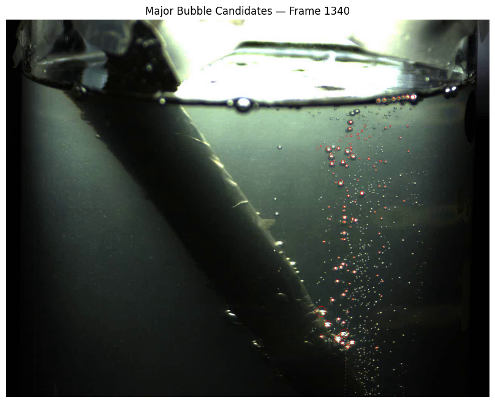

# High-Speed Video Bubble Size Analyzer

## Overview
This project explores a computer vision approach for analyzing
bubble-like features in high-speed video recordings using Python
and OpenCV.

The prototype detects candidate features in selected video frames,
estimates their apparent diameters in pixels, and calculates
descriptive statistics to characterize their size distribution.

## Objectives
- Process video frames using computer vision.
- Detect candidate bubble-like features.
- Estimate apparent feature diameters.
- Calculate mean, median, and standard deviation.
- Analyze features across multiple sampled frames.
- Export measurements and summary statistics to CSV.

## Technologies
- Python
- OpenCV
- NumPy
- Pandas
- Matplotlib
- Jupyter Notebook
- Google Colab

## Methodology
1. Load the video and extract selected frames.
2. Convert frames to grayscale.
3. Apply Gaussian blur to reduce image noise.
4. Use thresholding and contour detection to identify candidate features.
5. Estimate apparent diameters using enclosing circles.
6. Calculate descriptive statistics.
7. Export the results for further analysis.

## Current Results
For one analyzed frame, the prototype reported:

| Metric | Result |
|---|---:|
| Candidate features retained | 51 |
| Mean apparent diameter | 9.00 pixels |
| Median apparent diameter | 8.06 pixels |
| Standard deviation | 4.87 pixels |

These results are preliminary and depend on the detection and
filtering parameters. Detected features may include reflections,
overlapping bubbles, or other image artifacts.

## Limitations
- Physical bubble sizes require a validated pixel-to-micrometre calibration.
- The provisional conversion factor has not yet been verified.
- Overlapping features and reflections can affect detection accuracy.
- Bubbles below the optical resolution cannot be reliably measured
  using this video alone.
- The current implementation uses classical computer vision rather
  than a trained machine-learning model.

## Future Work
- Validate detections against manually annotated frames.
- Establish a reliable image calibration.
- Improve detection of overlapping features.
- Evaluate performance across additional videos.
- Explore automated feature detection and measurement validation.

## Disclaimer
This repository presents an experimental image-analysis prototype.
The reported measurements are preliminary and should not be treated
as validated physical bubble-size measurements.
## Visual Analysis

### 1. Original Frame with Pixel Coordinates

The coordinate grid illustrates the image coordinate system used
to locate candidate features in the video frame.

### 2. Candidate Bubble Detection

The image below shows candidate bubble-like features identified
by the contour-based detection pipeline in frame 1340.

*Note: Detected features are preliminary candidates and may include
reflections, overlapping bubbles, and other image artifacts.*
