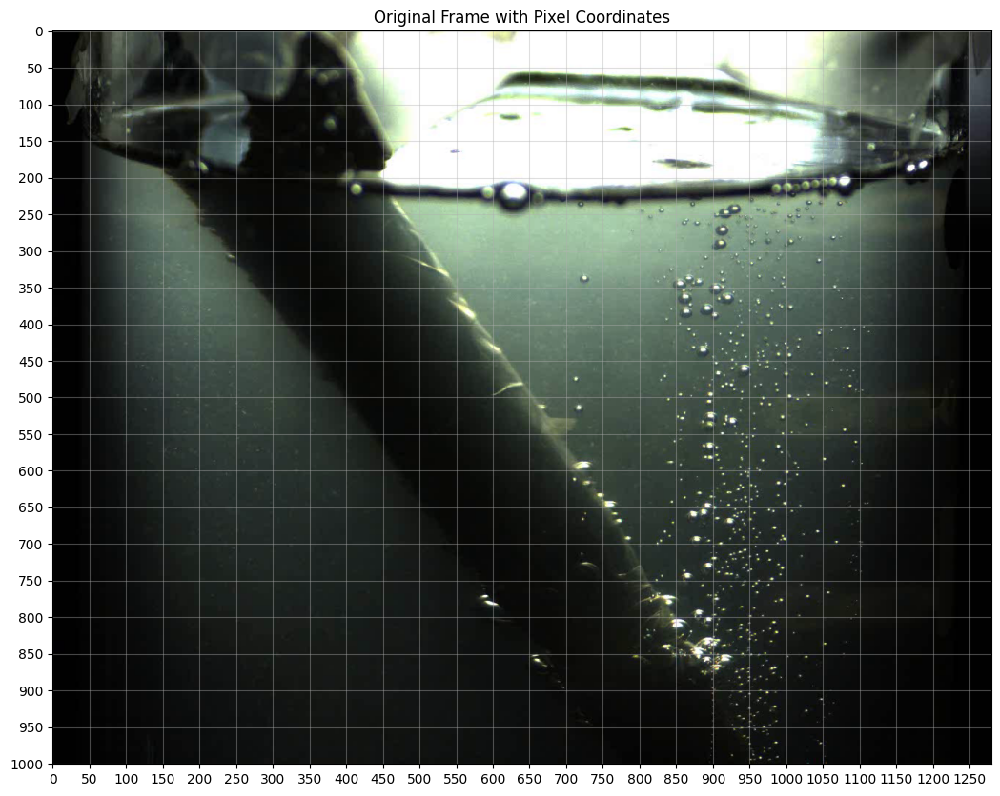

# High-Speed Video Bubble Size Analyzer

## Overview

This project explores a computer vision approach for analyzing bubble-like features in high-speed video recordings using Python and OpenCV.

The prototype processes selected video frames, detects candidate features, estimates their apparent diameters in pixels, and calculates descriptive statistics to characterize their size distribution.

## Objectives

* Process video frames using computer vision.
* Detect candidate bubble-like features.
* Estimate apparent feature diameters in pixels.
* Calculate mean, median, and standard deviation.
* Analyze candidate features across multiple sampled frames.
* Export measurements and summary statistics to CSV.

## Technologies

* Python
* OpenCV
* NumPy
* Pandas
* Matplotlib
* Jupyter Notebook
* Google Colab

## Methodology

1. Load the video and extract selected frames.
2. Convert frames to grayscale.
3. Apply Gaussian blurring to reduce image noise.
4. Use thresholding and contour detection to identify candidate features.
5. Estimate apparent diameters using enclosing circles.
6. Calculate descriptive statistics.
7. Export measurement data and summary statistics to CSV files.

## Preliminary Results

For one analyzed frame (Frame 1340), the prototype reported the following results after filtering candidate features:

| Metric                      |      Result |
| --------------------------- | ----------: |
| Candidate features retained |          51 |
| Mean apparent diameter      | 9.00 pixels |
| Median apparent diameter    | 8.06 pixels |
| Standard deviation          | 4.87 pixels |

These results are preliminary and depend on the selected image-processing parameters. Detected features may include reflections, overlapping bubbles, or other image artifacts.

The reported values describe apparent image-feature diameters in pixels; they are not validated physical bubble-size measurements.

## Visual Analysis

### 1. Original Frame with Pixel Coordinates

The coordinate grid illustrates the image coordinate system used to locate candidate features within the video frame.

### 2. Candidate Bubble Detection

The following visualization shows candidate bubble-like features identified by the contour-based detection pipeline in Frame 1340.

*Note: The marked features are preliminary detections and may include reflections, overlapping bubbles, or other image artifacts.*

## Limitations

* Physical bubble sizes require a validated pixel-to-micrometre calibration.
* The provisional pixel-to-micrometre conversion has not yet been verified.
* Reflections and overlapping features can affect detection accuracy.
* Features below the optical resolution cannot be reliably measured from the video.
* The current implementation uses classical computer vision rather than a trained machine-learning model.

## Future Work

* Validate detections against manually annotated video frames.
* Establish a reliable image calibration factor.
* Improve detection of overlapping features and reflections.
* Evaluate the method across additional video frames and recordings.
* Quantify detection accuracy using appropriate validation metrics.
* Explore automated feature detection and measurement validation.

## Disclaimer

This repository presents an experimental image-analysis prototype. Its results are preliminary and should not be treated as validated physical bubble-size measurements.

